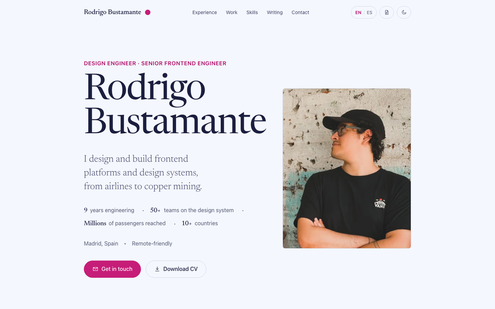

# rodrigobustamante.cl

[](https://github.com/rodrigobustamante/personal-site/actions/workflows/ci.yml)
[](LICENSE.md)
[](https://rodrigobustamante.cl)

Source of my personal site: portfolio, case studies and a blog on web performance and design systems. Bilingual (English and Spanish), with light and dark themes.

<a href="https://rodrigobustamante.cl">
  <picture>
    <source media="(prefers-color-scheme: dark)" srcset="docs/preview-dark.png" />
    
  </picture>
</a>

## What's inside

- **Case studies** ([/work](https://rodrigobustamante.cl/work)): Hangar Design System, LATAM Airlines home page, a mining supplier platform, PACE and Intervalo.
- **Blog** ([/blog/en](https://rodrigobustamante.cl/blog/en)): MDX posts in English and Spanish, with an RSS feed per language.
- **Design system** ([/system](https://rodrigobustamante.cl/system)): the tokens, type scale and components the site is built with. The full spec lives in [`DESIGN.md`](DESIGN.md).
- **Uses** ([/uses](https://rodrigobustamante.cl/uses)): how the site is built.
- **Edge language redirect**: a Cloudflare Worker sends visitors to `/` or `/es` based on their language before the static HTML is served.

## Stack

- [Astro](https://astro.build) with MDX, generated Open Graph images (Satori + Sharp), sitemap and RSS.
- Plain CSS with design tokens, self-hosted fonts (Newsreader and Hanken Grotesk).
- Cloudflare Workers with static assets, deployed with Wrangler.
- Quality gates in CI: ESLint, Prettier, unit tests (`node --test`), build and Lighthouse CI.

## Getting started

Requires Node.js 22+ and pnpm.

```bash
pnpm install
pnpm dev        # http://localhost:4321
pnpm build      # output in dist/
pnpm preview
```

Other scripts: `pnpm lint:eslint`, `pnpm format`, `pnpm test` and `pnpm lighthouse`.

## Writing a post

Add an `.mdx` file to `src/content/post/en` or `src/content/post/es`:

```markdown
---
publishDate: YYYY-MM-DDT00:00:00Z
title: Your post title
excerpt: Short description
image: ~/assets/images/posts/cover.jpg
category: Tutorials
draft: false
translation: /blog/es/your-post-slug # link to the other language, if any
tags:
  - tag
metadata:
  title: Your post title
  description: Short description
---

Your content here...
```

Case studies live in `src/content/work/en` and `src/content/work/es`.

## License

[MIT](LICENSE.md) © Rodrigo Bustamante. Blog posts and case studies are my own writing; please link back rather than republishing them.
